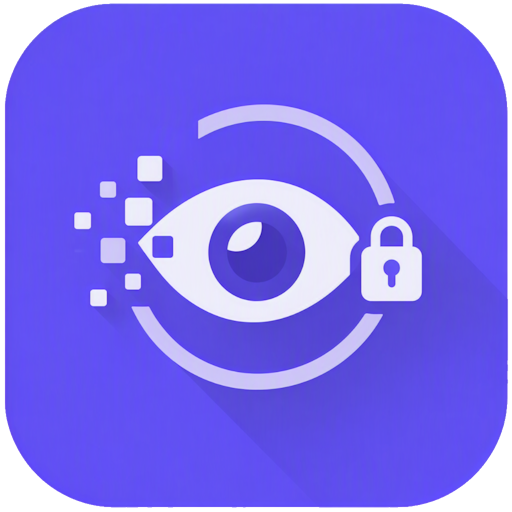
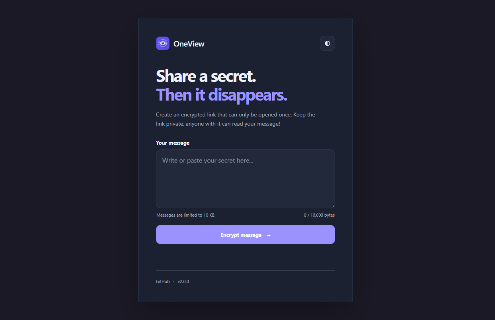

<p align="center">
    
</p>

<h1 align="center">OneView</h1>
<h3 align="center">Encrypted Message Sharing</h3>

<p align="center">
  <a href="https://github.com/arizon-dev/oneview/releases">
    
  </a>
  <a href="https://github.com/arizon-dev/oneview/blob/main/LICENSE">
    
  </a>
  <a href="https://app.codacy.com/gh/arizon-dev/oneview/dashboard?utm_source=gh&utm_medium=referral&utm_content=&utm_campaign=Badge_grade">
    
  </a>
</p>

> A small, self-hosted service for sharing encrypted messages through links that can only be viewed once. Available in all languages, provided by Google Translate.

**Demo:** [oneview.arizon.dev](https://oneview.arizon.dev)

<p align="center">
    
</p>

## How it works

Write a message and OneView creates a link containing a randomly generated decryption key. Messages are encrypted with AES-128-GCM before storage. The message is returned when the recipient opens it, then its stored record is deleted. Messages are limited to **10,000 bytes**.

The link is a bearer secret: anyone who gets it can view the message. Use HTTPS and share links only through trusted channels.

## Requirements

- PHP 7.4 or later with the **OpenSSL** and **JSON** extensions.
- A web server configured to route application paths to `index.php`. Apache deployments can use the included `.htaccess` rules and require `mod_rewrite` and `AllowOverride` support.
- A PHP-writable `local/` directory for the cache and file-backed records.
- For MySQL storage only: PHP `mysqli` and a MySQL-compatible database.

## Install

1. Download and extract the [latest release](https://github.com/arizon-dev/oneview/releases) into the web server's document root or a subdirectory.
2. Ensure the PHP process can write to `local/`.
3. Point the web server to the `root/` folder. This is where the application is served from.
4. Create the `config.json`. Choose `json` to store records in local files, or `mysql` to use a database:

   ```json
   {
     "STORAGE_METHOD": "json",
     "LANGUAGE": "auto",
     "DEBUG_MODE": "false"
   }
   ```

   Available list of language codes are listed here: [developers.google.com](https://developers.google.com/workspace/admin/directory/v1/languages).

   > Translations are cached. When the language is changed, it may take a few seconds to load the page for the first time whilst the system downloads the new translations.

5. For MySQL, create the `local/database.json` file and specify the connection details:

   ```json
   {
     "HOSTNAME": "database.example.com",
     "PORT": "3306",
     "USERNAME": "oneviewuser",
     "PASSWORD": "password123",
     "DATABASE": "oneview"
   }
   ```

   OneView creates its records table during initialization. Use a database account with only the permissions the application needs.

6. Visit the installation URL and test creating and opening a message.

Keep all contents of the `local/` directory private. This directory includes database credentials, and message encryptions (if using JSON as storage method).

The included Apache `.htaccess` rules deny direct access to the storage directory and sensitive file extensions. If you use Nginx or another web server, configure equivalent rules to deny web access to `local/`, `config.json`, and database credentials.

## Storage options

| Method  | Where encrypted records are stored    | Suitable for                         |
| ------- | ------------------------------------- | ------------------------------------ |
| `json`  | JSON files under `local/encryptions/` | A simple, single-server installation |
| `mysql` | The `oneview_records` database table  | Installations already using MySQL    |

## Privacy and security notes

- The decryption key is part of the link. Anyone with the link can read the message; do not post it publicly.
- Use HTTPS. Avoid forwarding, logging, or embedding links in third-party services.
- The app records the visitor's IP address with each message (this is deleted once the message has been viewed). Consider this when setting your privacy notice and retention practices.
- Deletion happens after a successful view; it is not a substitute for protecting the link or securing the host and its backups.
- New records use authenticated AES-GCM encryption. Records from older versions of this project will use the legacy encryption format for compatibility.

## Contributing and support

Bug reports and feature suggestions are welcome through [GitHub Issues](https://github.com/arizon-dev/oneview/issues). Please do not report security vulnerabilities in public issues; follow the private reporting guidance in [SECURITY.md](./SECURITY.md).

## License

OneView is released under the [MIT License](./LICENSE).
